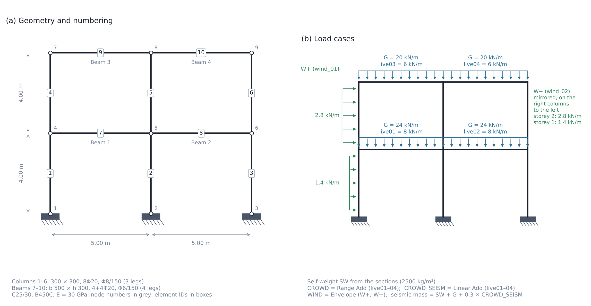

# Verified example: 2-storey, 2-bay RC portal

This is the verification example of ARCOPY (Section 3 of the paper). The same frame is modelled in
SAP2000 in `verification/sap2000`. `inputs.txt` holds the answers to all
118 prompts, so the whole workflow (model → loads and load groups → static → EC2 →
modal → EC8 RSA → performance summary → smart retrofit search → report) runs without
typing. `tests/verify_test_rc_portal.py` checks the results against an independent
calculation (56 checks, all passed).



## The structure

| Item | Value |
|---|---|
| Geometry | 2 storeys of 4.00 m, 2 bays of 5.00 m, fixed bases |
| Materials | concrete C25/30, E = 30 GPa, density 2500 kg/m³; steel B450C |
| Columns (elements 1–6) | 300 × 300 mm, 8Φ20 (3 top + 3 bottom + 1 + 1 side), stirrups Φ8/150, 3 legs |
| Beams (elements 7–10) | b = 500 mm, h = 300 mm, 4Φ20 top + 4Φ20 bottom, stirrups Φ6/150, 4 legs |
| SW | self-weight of the members |
| G | 24 kN/m on the floor-1 beams, 20 kN/m on the roof beams |
| live01, live02 | 8 kN/m on Beam 1 (element 7) and Beam 2 (element 8), floor 1 |
| live03, live04 | 6 kN/m on Beam 3 (element 9) and Beam 4 (element 10), roof |
| W+ (wind_01) | on the left exterior columns, to the right: 1.4 kN/m on storey 1 (element 1), 2.8 kN/m on storey 2 (element 4) |
| W− (wind_02) | mirrored, on the right exterior columns, to the left: 1.4 kN/m on storey 1 (element 3), 2.8 kN/m on storey 2 (element 6) |
| Load groups | CROWD = Range Add (live01–04); CROWD_SEISM = Linear Add (live01–04); WIND = Envelope (W+; W−) |
| Seismic mass | SW + G + 0.3 × CROWD_SEISM |

Other data of the example:

- concrete cover 30 mm (beams and columns), measured to the bar centre in the stiffness model;
- concrete density 2500 kg/m³ (unit weight 24.525 kN/m³ with g = 9.81 m/s²);
- existing building, EN 1998-3, knowledge level KL2 (confidence factor 1.2: the EC2 checks use fck = 20.8 MPa and fyk = 375 MPa);
- EC8 action: ag = 0.25 g, ground type B, spectrum type 1, 5 % damping, γI = 1.0, CQC, q = 1.5, ν = 0.5; 2 modes;
- retrofit: smart search, budget 40 complete analyses, default costs and jacketing limits.

### How ARCOPY models the frame

- Members are elastic Euler–Bernoulli elements (no shear deformation, no rigid end zones).
- Section properties are **transformed**: concrete plus the top and bottom bars with
  n = Es/Ec = 200/30 (side bars of the columns are not included).
  Beams: A = 0.16676 m², I = 1.3663·10⁻³ m⁴ (gross 0.150 m², 1.125·10⁻³ m⁴);
  columns: A = 0.10257 m², I = 8.560·10⁻⁴ m⁴ (gross 0.090 m², 6.75·10⁻⁴ m⁴).
- Static analyses use the full stiffness; the seismic analyses use EI × 0.5 (EC8 4.3.1(7)).
- Seismic mass: every vertical line load of the mass combination is lumped half to each end
  node of its member, collected per floor (halves at the base are dropped) and split equally
  among the nodes of the floor, horizontal direction only.

## Run it

Delete the folder `test_rc_portal` next to `main.py` first if it exists (otherwise ARCOPY
offers to resume the saved run). From the ARCOPY folder:

```
python main.py < examples/test_rc_portal/inputs.txt          (Anaconda Prompt / cmd, Linux, macOS)
Get-Content examples\test_rc_portal\inputs.txt | python main.py   (PowerShell)
!python main.py < examples/test_rc_portal/inputs.txt         (Spyder IPython console)
```

To run without figure windows set the Matplotlib backend first (`set MPLBACKEND=Agg` in cmd).
The run takes about 40 s.

## Expected results

| Quantity | Value |
|---|---|
| Seismic mass | floor 1: 33,361 kg (327.3 kN); roof: 27,322 kg (268.0 kN) |
| Periods (EI × 0.5) | T1 = 0.819 s (91.0 % of the mass), T2 = 0.283 s (9.0 %) |
| Static EC2, before retrofit | beams 7–8 η = 1.73, beams 9–10 η = 1.45 (shear, ULS_Q_leading_W±); columns η ≤ 0.54 |
| EC8 RSA drifts (DLS, ν = 0.5) | storey 1: 0.63 % (utilization 1.25); storey 2: 0.56 % (1.12) – both fail the 0.5 % limit |
| Smart search | 194 proposals, 35 strategies analysed, converged |
| Selected strategy | new wall in bay 1, storey 1, 200 mm + 75 mm jackets on beams 7–10 |
| Cost | 14,630 EUR (wall 8,593 + jacketing 6,037); η max after retrofit 0.99 |

The files in `reference_results/` were produced by this input with ARCOPY v1.3.0 (Python 3.13,
OpenSeesPy 3.8, Optuna 5.1).

## Verification

```
python tests/verify_test_rc_portal.py
```

The script runs the example, reads its checkpoints and compares ARCOPY (OpenSees through
`framekit`) with an independent direct-stiffness calculation written with numpy only:

| # | What is checked | Result |
|---|---|---|
| 1 | the input file builds the described model: nodes, elements, sections, E, density, fck/fyk (and /CF), the loads of every case, the load groups, ψ = 0.3 | 23 checks passed |
| 2 | member end forces N, V, M of SW, G, live01–04, W+, W− | equal to ~10⁻¹⁴ (relative) |
| 3 | equilibrium of the base reactions (SW 126.55 kN, G 440 kN, live 40/40/30/30 kN, wind 16.8 kN) | passed |
| 4 | load groups at result level: CROWD vs the 16 explicit patterns, CROWD_SEISM, WIND, ULS_Q_leading_W+, 1.35SW+1.35G+1.5CROWD+0.9WIND (32 alternatives), at 41 sections of every member | equal to ~10⁻¹⁴ |
| 5 | seismic mass per floor vs the hand calculation | equal |
| 6 | T1, T2 vs an independent eigen solution | equal to 10⁻⁶ |

Some verified values (kN, kNm; N tension +, M sagging +):

| Quantity | Value |
|---|---|
| G, base reactions (nodes 1, 2, 3) | Ry = 100.30, 239.39, 100.30 kN |
| W+, base shears (nodes 1, 2, 3) | Rx = −6.91, −5.49, −4.40 kN (total 16.8 kN) |
| CROWD (Range Add), Beam 1 | M at the right end: −20.19 / +1.20; M in the span: max +12.31 |
| ULS_Q_leading_W+, Beam 1 | M min −125.53 (right end), M max +66.17 (span) |

The script also writes `reference_results/verification/`:

| File | Content |
|---|---|
| `member_end_forces_arcopy_model.csv` | N, V, M at both ends of every member, every basic case (ARCOPY model = transformed sections) |
| `member_end_forces_gross_sections.csv` | the same with gross concrete sections (SAP2000 default) |
| `group_envelopes.csv` | max / min of N, V, M at the ends and along the members for the group combinations |
| `base_reactions.csv`, `floor_masses.csv`, `periods.csv`, `section_properties.csv` | reactions; masses; periods of four stiffness models; A, I and the SAP2000 property modifiers |
| `verification_checks.csv` | every check with the two values |

## Comparison with SAP2000

The comparison of this example with SAP2000 v24.2.0 is in `verification/sap2000`: the scripts
that build the SAP2000 models, the result tables and the statistics (9,282 static values equal
to the last digit printed by SAP2000; periods and response-spectrum results equal with the same
mass model). The notes below are for building the model by hand.

To reproduce the ARCOPY model in SAP2000:

1. Frame property modifiers: beams A = 1.1117, I33 = 1.2145; columns A = 1.1396, I33 = 1.2681
   (transformed sections), or keep 1.0 and compare with `member_end_forces_gross_sections.csv`.
2. No shear deformation (shear area modifiers = 0), no end offsets.
3. Concrete unit weight 24.525 kN/m³ (= 2500 × 9.81), E = 30 GPa.
4. Mass source: SW + G + 0.3 × (live01 + live02 + live03 + live04), lateral mass only. ARCOPY
   splits the mass of each floor equally among the joints of the floor; SAP2000 uses the
   tributary mass of each joint, which changes the axial forces of the beams in the response
   spectrum case (see `verification/sap2000/README.md`).
   For the ARCOPY periods use I33 × 0.5 in the modal case; `periods.csv` also lists the
   uncracked and gross-section periods (T1 = 0.580 s uncracked; 0.648 s gross; 0.916 s gross × 0.5).
5. Export to Excel: *Element Forces – Frames*, *Joint Reactions*, *Modal Periods and Frequencies*,
   *Modal Participating Mass Ratios*, *Connectivity – Frame* and *Joint Coordinates* (to match the numbering).

Sign conventions: ARCOPY gives N tension positive, V = dM/dx, M positive with tension on the
bottom face of beams and on the right face (+X) of columns; *start* is the bottom of a column
and the left end of a beam. With SAP2000's default local axes: P = N; beams M3 = M and
V2 = −V; columns M3 = −M and V2 = V.

## The 118 answers

| # | Prompt | Answer |
|---|---|---|
| 1 | Run name / folder [run_&lt;date&gt;]: | `test_rc_portal` |
| 2 | Structure type (RC / Steel): | `rc` |
| 3 | Number of floors: | `2` |
| 4 | Floor height [m]: | `4` |
| 5 | Number of bays: | `2` |
| 6 | Length of bay 1 [m]: | `5` |
| 7 | Length of bay 2 [m]: | `5` |
| 8 | Add a shear wall panel? (y/n): | `n` |
| 9 | Select option (1/2/3) [1]: | `3` |
| 10 | Width b [mm] [300.0]: | `500` |
| 11 | Height h [mm] [500.0]: | `300` |
| 12 | Concrete cover [mm] [30.0]: | `30` |
| 13 | Top bars number [3]: | `4` |
| 14 | Top bar diameter [mm] [16.0]: | `20` |
| 15 | Bottom bars number [3]: | `4` |
| 16 | Bottom bar diameter [mm] [16.0]: | `20` |
| 17 | Stirrup/tie diameter [mm] [8.0]: | `6` |
| 18 | Stirrup/tie spacing s [mm] [150.0]: | `150` |
| 19 | Number of stirrup/tie legs [2]: | `4` |
| 20 | Use smaller stirrup spacing in critical end zones? (y/n) [n]: | `n` |
| 21 | Width b [mm] [400.0]: | `300` |
| 22 | Height h [mm] [400.0]: | `300` |
| 23 | Concrete cover [mm] [35.0]: | `30` |
| 24 | Top-face bars including corners [4]: | `3` |
| 25 | Top-face bar diameter [mm] [16.0]: | `20` |
| 26 | Bottom-face bars including corners [4]: | `3` |
| 27 | Bottom-face bar diameter [mm] [16.0]: | `20` |
| 28 | Left-side intermediate bars excluding corners [2]: | `1` |
| 29 | Right-side intermediate bars excluding corners [2]: | `1` |
| 30 | Side-face bar diameter [mm] [16.0]: | `20` |
| 31 | Stirrup/tie diameter [mm] [8.0]: | `8` |
| 32 | Stirrup/tie spacing s [mm] [100.0]: | `150` |
| 33 | Number of stirrup/tie legs [4]: | `3` |
| 34 | Use smaller stirrup spacing in critical end zones? (y/n) [n]: | `n` |
| 35 | Select option (1/2): | `2` |
| 36 | Concrete fck [MPa]: | `25` |
| 37 | Steel fyk [MPa]: | `450` |
| 38 | Change gamma_c? (default 1.5) (y/n): | `n` |
| 39 | Change gamma_s? (default 1.15) (y/n): | `n` |
| 40 | Change alpha_cc? (default 0.85) (y/n): | `n` |
| 41 | Select (1/2) [2]: | `2` |
| 42 | Knowledge level [KL1/KL2/KL3] (default KL2): | `KL2` |
| 43 | Plot selected RC beam/column sections? (y/n) [y]: | `n` |
| 44 | Concrete E [MPa]: | `30000` |
| 45 | Concrete density [kg/m3]: | `2500` |
| 46 | Select (1/2) [1]: | (Enter = default) |
| 47 | G distributed load on floor 1 [kN/m] (magnitude, applied downward): | `24` |
| 48 | G distributed load on roof [kN/m] (magnitude, applied downward): | `20` |
| 49 | Number of live load cases (0 = none) [0]: | `4` |
| 50 | Live case 1 name [live01]: | (Enter = default) |
| 51 | live01: load [kN/m] (magnitude, applied downward): | `8` |
| 52 | live01: floors (all \| 1,3 \| 1-3; roof = 2) [all]: | `1` |
| 53 | live01: bays (all \| 1,3 \| 2-4) [all]: | `1` |
| 54 | Add more beams to live01 with another load? (y/n) [n]: | `n` |
| 55 | Live case 2 name [live02]: | (Enter = default) |
| 56 | live02: load [kN/m] (magnitude, applied downward): | `8` |
| 57 | live02: floors (all \| 1,3 \| 1-3; roof = 2) [all]: | `1` |
| 58 | live02: bays (all \| 1,3 \| 2-4) [all]: | `2` |
| 59 | Add more beams to live02 with another load? (y/n) [n]: | `n` |
| 60 | Live case 3 name [live03]: | (Enter = default) |
| 61 | live03: load [kN/m] (magnitude, applied downward): | `6` |
| 62 | live03: floors (all \| 1,3 \| 1-3; roof = 2) [all]: | `2` |
| 63 | live03: bays (all \| 1,3 \| 2-4) [all]: | `1` |
| 64 | Add more beams to live03 with another load? (y/n) [n]: | `n` |
| 65 | Live case 4 name [live04]: | (Enter = default) |
| 66 | live04: load [kN/m] (magnitude, applied downward): | `6` |
| 67 | live04: floors (all \| 1,3 \| 1-3; roof = 2) [all]: | `2` |
| 68 | live04: bays (all \| 1,3 \| 2-4) [all]: | `2` |
| 69 | Add more beams to live04 with another load? (y/n) [n]: | `n` |
| 70 | Choose profile (1/2) [1]: | (Enter = default) |
| 71 | W+ distributed load on the storey 1 column (ground storey) [kN/m] (0 if none): | `1.4` |
| 72 | W+ distributed load on the storey 2 column (top storey) [kN/m] (0 if none): | `2.8` |
| 73 | Apply at the same time on the right (leeward) exterior columns the same W+ loads, in the same direction, multiplied by a coefficient? (y/n) [n]: | `n` |
| 74 | Use the same storey loads (and leeward coefficient) for W-, mirrored? (y/n) [y]: | (Enter = default) |
| 75 | Add extra load? (y/n): | `n` |
| 76 | Keep these groups? (y/n) [y]: | (Enter = default) |
| 77 | Variable load Q (CROWD / CROWD_SEISM / WIND / none) [CROWD]: | (Enter = default) |
| 78 | Live load in the seismic mass (CROWD / CROWD_SEISM / WIND / none) [CROWD_SEISM]: | (Enter = default) |
| 79 | Seismic mass = SW + G + psi x that group (all members loaded);  psi [0.3]: | (Enter = default) |
| 80 | Add another load combination of your own? (y/n) [n]: | (Enter = default) |
| 81 | Number of sections along each BEAM [Enter = built-in]: | (Enter = default) |
| 82 | Number of sections along each COLUMN [Enter = built-in]: | (Enter = default) |
| 83 | Run EC2 checks for ULS combinations? (y/n): | `y` |
| 84 | Show colored verification table? (y/n): | `n` |
| 85 | Show utilization colored on structure? (y/n): | `n` |
| 86 | Select option (1/2/3): | `3` |
| 87 | Go to dynamic analysis now? (y/n): | `y` |
| 88 | Additional lumped mass per floor [kg] (0 if none): | `0` |
| 89 | Use rigid diaphragm per floor? (y/n): | `n` |
| 90 | Cracked stiffness factor EI_eff/EI for seismic analyses (EC8 4.3.1(7)) [default 0.5]: | (Enter = default) |
| 91 | Number of eigen modes to compute [max 18]: | `2` |
| 92 | Plot floor mode-shape curves? (y/n): | `n` |
| 93 | Plot full deformed structure for each mode? (y/n): | `n` |
| 94 | Run EC8 response spectrum analysis (design spectrum, q-factor)? (y/n): | `y` |
| 95 | Spectrum: 1) EN 1998-1   2) NTC 2008 (Italy) [1]: | (Enter = default) |
| 96 | Design ground acceleration ag/g [e.g. 0.35]: | `0.25` |
| 97 | Soil class [A/B/C/D/E]: | `B` |
| 98 | Spectrum type [1 or 2] (default 1): | `1` |
| 99 | Damping ratio ξ as decimal [default 0.05]: | `0.05` |
| 100 | Importance factor γI [default 1.0]: | `1` |
| 101 | Modal combination [CQC/SRSS] (default CQC): | `CQC` |
| 102 | Behaviour factor q [default 1.50]: | (Enter = default) |
| 103 | Plot EC8 spectrum? (y/n): | `n` |
| 104 | Select (1/2/3) [1]: | `1` |
| 105 | Reduction factor ν [default 0.50 (importance I-II), 0.40 for III-IV]: | (Enter = default) |
| 106 | Run linear time-history analysis? (y/n): | `n` |
| 107 | Build global performance summary (static + RSA + TH)? (y/n): | `y` |
| 108 | Run retrofit optimization? (y/n): | `y` |
| 109 | Max wall segments per layout (1-2) [default 2]: | (Enter = default) |
| 110 | Choose search method [default 2]: | `2` |
| 111 | Number of smart trials (complete strategies) [default 60]: | `40` |
| 112 | Use default retrofit cost parameters? (y/n) [y]: | (Enter = default) |
| 113 | Max ratio jacketed / original section dimension [default 1.5]: | (Enter = default) |
| 114 | Max jacket thickness [mm] [default 200]: | (Enter = default) |
| 115 | Include the EC8 seismic action in the retrofit (lateral force method per candidate)? (y/n) [y]: | (Enter = default) |
| 116 | Use the seismic parameters of the RSA step (q = 1.50, ag = 0.250 g)? (y/n) [y]: | (Enter = default) |
| 117 | Plot before/after RC sections for jacketed members? (y/n) [y]: | (Enter = default) |
| 118 | Generate the retrofit report (Word + Excel)? (y/n) [y]: | (Enter = default) |
